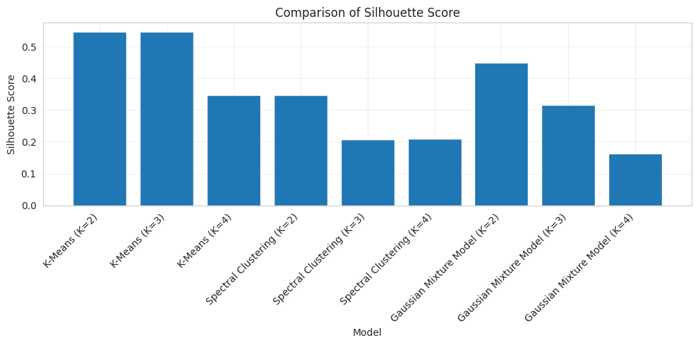
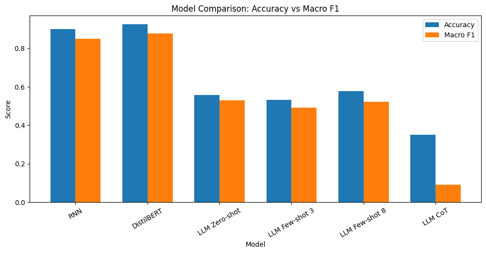
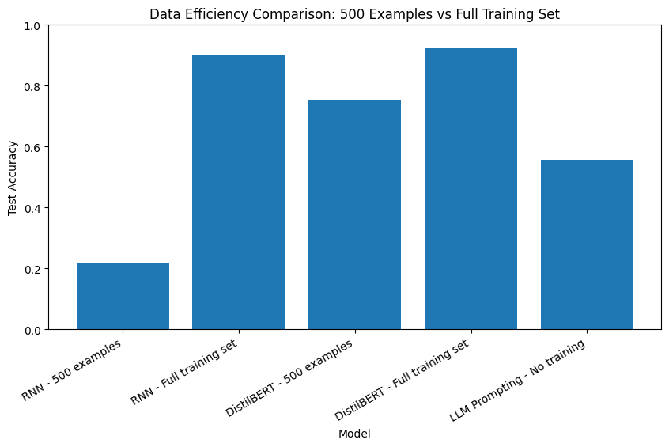

# Advanced Machine Learning Projects

Three course projects spanning unsupervised learning, multimodal deep learning, and NLP/LLM evaluation.

| Project | Task | Approach | Headline result |
|---|---|---|---|
| [`01-clustering/`](01-clustering/) | Unsupervised segmentation of wholesale customers | K-Means, Spectral Clustering, GMM — compared with 5 internal validation metrics | K-Means (K = 3) selected: Silhouette 0.548, Davies-Bouldin 0.928 |
| [`02-image-captioning/`](02-image-captioning/) | Generate natural-language captions for images | CNN (InceptionV3) encoder + multi-task LSTM decoder, trained on MS-COCO | BLEU-1 0.283 after a 1-epoch run on a COCO subset (limited compute) |
| [`03-emotion-classification/`](03-emotion-classification/) | Classify text into 6 emotions | RNN baseline vs. fine-tuned DistilBERT vs. zero/few-shot & chain-of-thought LLM prompting | Fine-tuned DistilBERT 92.4% accuracy vs. 90.1% for the RNN and 57.7% for the best LLM prompt |

Each subfolder contains the original notebook, unmodified, plus a README summarizing the approach and the results as logged by the notebook's own output cells.

## Highlights

**Clustering: every (algorithm, K) combination compared on Silhouette Score.** K-Means is ahead of Spectral Clustering and GMM; the other four validation metrics are in the notebook and the [report](01-clustering/AML-REPORT-proj1.pdf).

**Emotion classification: accuracy vs. macro F1 for six approaches on the same 2,000-example test set.** Fine-tuned DistilBERT leads; chain-of-thought prompting scores lowest, a counter-intuitive result that is kept in the write-up.

**Data efficiency: with only 500 training examples** DistilBERT still reaches 75.1% accuracy while the RNN drops to 21.8%.

## Honest limitations

- **Image captioning** was trained for a single epoch (`EPOCHS = 1`) on a reduced COCO subset because of limited compute, and its generated captions are still repetitive. The BLEU scores describe an early-stage model, not a tuned one; see [`02-image-captioning/`](02-image-captioning/).
